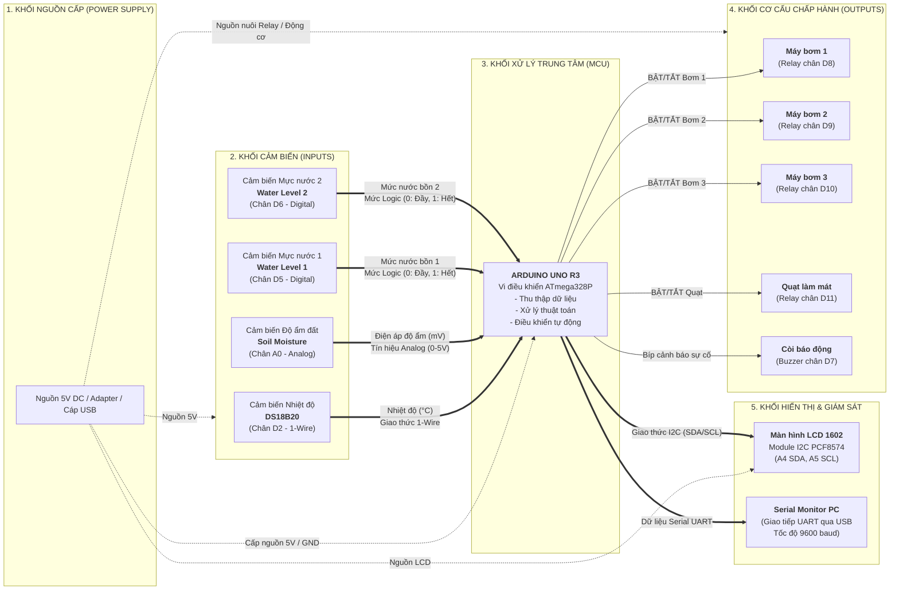

# SƠ ĐỒ KHỐI HỆ THỐNG (SYSTEM BLOCK DIAGRAM)
**Dự án STEM:** Hệ thống giám sát & Điều khiển Nông nghiệp thông minh  
**Lớp:** 9/13  
**Học sinh / Nhóm thực hiện:** Nguyễn Văn Ba  
**Mã nguồn liên quan:** [`stem_9A13.ino`](stem_9A13.ino)

---

## 1. Sơ đồ khối tổng thể (System Block Diagram)

Dưới đây là sơ đồ khối chi tiết thể hiện mối liên kết giữa Khối Nguồn, Khối Cảm biến (Đầu vào), Khối Vi điều khiển (Xử lý trung tâm), Khối Cơ cấu chấp hành (Đầu ra) và Khối Hiển thị:



---

## 2. Mô tả chi tiết chức năng các khối

### 2.1. Khối nguồn (Power Supply)
- **Nhiệm vụ:** Cung cấp nguồn điện một chiều $5\text{V DC}$ ổn định cho toàn bộ mạch điều khiển, cảm biến và các cơ cấu chấp hành.
- **Thành phần:** Cáp nạp USB từ máy tính hoặc Adapter nguồn ngoài $5\text{V} - 2\text{A}$ cắm qua Jack DC / chân `VIN`.

### 2.2. Khối xử lý trung tâm (Central Processing Unit - MCU)
- **Thiết bị:** Bo mạch vi điều khiển **Arduino Uno R3 (ATmega328P)**.
- **Nhiệm vụ:**
  - Nhận và đọc dữ liệu định kỳ mỗi $500\text{ ms}$ từ các cảm biến nhiệt độ, độ ẩm đất, mực nước.
  - Xử lý giải thuật điều khiển và hiệu chuẩn:
    - Quy đổi ADC sang điện áp ($mV$) và ánh xạ sang $\%$ độ ẩm đất.
    - Áp dụng thuật toán trễ (Hysteresis) để điều khiển Bơm 3 và Quạt chống đóng ngắt liên tục.
  - Ra quyết định điều khiển đóng/ngắt các Relay và phát còi cảnh báo.
  - Gửi dữ liệu hiển thị ra LCD 16x2 và cổng Serial máy tính.

### 2.3. Khối cảm biến (Sensors - Inputs)
| Tên cảm biến | Chân kết nối | Chuẩn giao tiếp | Vai trò |
|:---|:---:|:---:|:---|
| **DS18B20** | **D2** | 1-Wire | Đo nhiệt độ môi trường / nước với độ chính xác cao |
| **Soil Moisture Sensor** | **A0** | Analog ($0 - 5\text{V}$) | Đo độ ẩm đất qua điện trở tiếp xúc ($680 - 2189\text{ mV}$) |
| **Water Level Sensor 1** | **D5** | Digital (0 / 1) | Giám sát mức nước bồn 1 (`0`: Đầy, `1`: Cạn) |
| **Water Level Sensor 2** | **D6** | Digital (0 / 1) | Giám sát mức nước bồn 2 (`0`: Đầy, `1`: Cạn) |

### 2.4. Khối cơ cấu chấp hành (Actuators - Outputs)
| Thiết bị | Chân điều khiển | Cơ chế hoạt động | Điều kiện kích hoạt tự động |
|:---|:---:|:---:|:---|
| **Máy bơm 1** | **D8** | Relay cách ly quang | BẬT khi bồn 1 cạn (`level1 == 1`), TẮT khi đầy (`level1 == 0`) |
| **Máy bơm 2** | **D9** | Relay cách ly quang | BẬT khi bồn 2 cạn (`level2 == 1`), TẮT khi đầy (`level2 == 0`) |
| **Máy bơm 3** | **D10** | Relay cách ly quang | BẬT khi đất khô ($< 10\%$), TẮT khi đất đủ ẩm ($\ge 50\%$) |
| **Quạt làm mát** | **D11** | Relay cách ly quang | BẬT khi nhiệt độ $> 35.0^\circ\text{C}$, TẮT khi nhiệt độ $< 30.0^\circ\text{C}$ |
| **Còi Buzzer** | **D7** | Kích trực tiếp / Transistor | Kêu bíp cảnh báo khi: Quá nhiệt, cạn nước bồn, hoặc đất quá khô |

### 2.5. Khối hiển thị & Giám sát (Display & Monitoring)
- **Màn hình LCD 1602 + Module I2C:**
  - Kết nối qua 2 dây tín hiệu: `A4` (SDA) và `A5` (SCL).
  - Dòng 0: Hiển thị giá trị nhiệt độ (`Nhiet do: 28.5°C`).
  - Dòng 1: Hiển thị giá trị độ ẩm đất (`Do am: 65%`).
- **Cổng Serial USB:**
  - Tốc độ truyền nhận `9600 baud`.
  - Cung cấp thông tin gỡ lỗi, giá trị ADC thô, điện áp mV và trạng thái chuyển đổi ON/OFF của từng máy bơm, quạt.

---

## 3. Luồng dữ liệu và điều khiển liên khối (Data Flow)

```text
[ CẢM BIẾN ] 
     │ (Dữ liệu nhiệt độ, độ ẩm, mực nước)
     ▼
[ ARDUINO UNO ] ───► [ MÀN HÌNH LCD 1602 ] (Hiển thị người dùng)
     │          ───► [ SERIAL MONITOR PC ]  (Ghi nhật ký hệ thống)
     │ (So sánh với cài đặt trong setting.h)
     ▼
[ KHỐI CHẤP HÀNH ]
  ├── Cạn nước bồn 1, 2 ──► Kích Bơm 1, Bơm 2 chạy
  ├── Đất khô < 10%    ──► Kích Bơm 3 tưới
  ├── Nhiệt độ > 35°C  ──► Kích Quạt làm mát
  └── Có bất kỳ sự cố ──► Kêu Còi Buzzer cảnh báo
```
