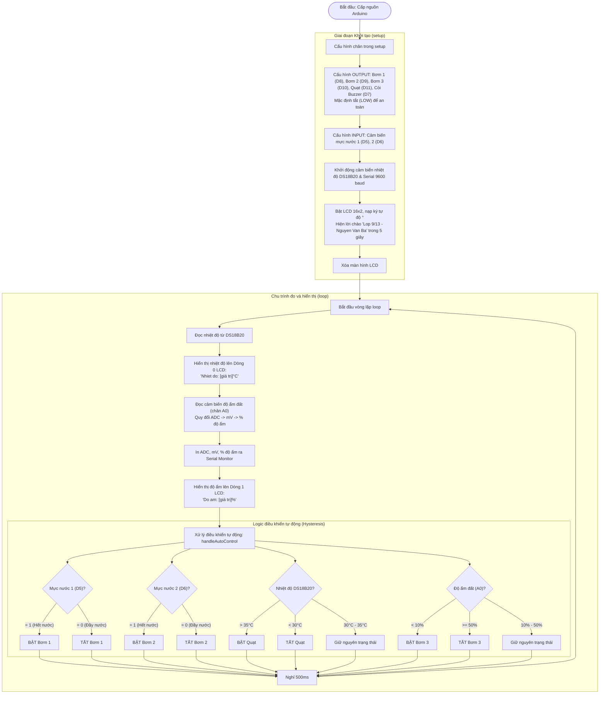

# TÀI LIỆU MÔ TẢ LUỒNG HOẠT ĐỘNG (WORKFLOW)
**Dự án STEM:** Hệ thống giám sát & Điều khiển Nông nghiệp thông minh  
**Lớp:** 9/13  
**Học sinh / Nhóm thực hiện:** Nguyễn Văn Ba  
**Mã nguồn liên quan:** [`stem_9A13.ino`](stem_9A13.ino)

---

## 1. Bảng phân bổ chân điều khiển & Cảm biến

| Nhóm | Thiết bị | Chân Arduino Uno | Chế độ (Mode) | Trạng thái ban đầu |
|:---|:---|:---:|:---:|:---:|
| **Điều khiển (Output)** | Còi Buzzer | **D7** | `OUTPUT` | `LOW` (Tắt) |
| | Máy bơm 1 | **D8** | `OUTPUT` | `LOW` (Tắt) |
| | Máy bơm 2 | **D9** | `OUTPUT` | `LOW` (Tắt) |
| | Máy bơm 3 | **D10** | `OUTPUT` | `LOW` (Tắt) |
| | Quạt làm mát | **D11** | `OUTPUT` | `LOW` (Tắt) |
| **Cảm biến mực nước (Input)** | Cảm biến mức 1 | **D5** | `INPUT` | Đọc mức nước |
| | Cảm biến mức 2 | **D6** | `INPUT` | Đọc mức nước |
| **Cảm biến môi trường** | Nhiệt độ DS18B20 | **D2** | 1-Wire | Có trở kéo 4.7kΩ |
| | Độ ẩm đất | **A0** | Analog In | $680 - 2189\text{ mV}$ |
| **Hiển thị** | LCD 16x2 I2C | **A4 (SDA), A5 (SCL)** | I2C | Địa chỉ `0x27` |

---

## 2. Sơ đồ lưu đồ hoạt động (Flowchart)

---

## 3. Chi tiết các giai đoạn hoạt động

### 3.1. Giai đoạn khởi động (`setup()`)
1. **Thiết lập an toàn cho các cơ cấu chấp hành (Bơm, Quạt, Còi):**
   - Các chân **D8, D9, D10** (Máy bơm 1, 2, 3), **D11** (Quạt) và **D7** (Còi Buzzer) được đặt ở chế độ `OUTPUT`.
   - Ngay lập tức ghi mức `LOW` để đảm bảo không thiết bị nào tự ý chạy khi vừa cắm điện.
2. **Thiết lập đầu vào cảm biến mực nước:**
   - Các chân **D5, D6** được cấu hình là `INPUT` để sẵn sàng đọc tín hiệu mức nước.
3. **Khởi động cảm biến nhiệt độ & truyền thông:**
   - Khởi động thư viện DS18B20 trên chân **D2**.
   - Mở cổng `Serial` ở tốc độ `9600` baud.
4. **Màn hình chào định danh (Splash Screen):**
   - Bật đèn nền LCD, nạp ký tự `°`.
   - In lời chào: `"====Lop 9/13===="` và `" Nguyen Van Ba "` trong $5\text{ giây}$.
   - Sau 5 giây, màn hình được xóa trắng sẵn sàng cho dữ liệu đo.

### 3.2. Giai đoạn chu trình đo & điều khiển tự động (`loop()`)
1. **Nhiệt độ:** Đọc giá trị qua giao tiếp 1-Wire và cập nhật lên dòng 0 màn hình LCD (`Nhiet do: ...°C`).
2. **Độ ẩm đất:** Đọc giá trị Analog từ chân `A0`, tính điện áp ($mV$) và quy đổi sang $\%$ độ ẩm ($2189\text{ mV} \rightarrow 0\%$ và $680\text{ mV} \rightarrow 100\%$), xuất lên dòng 1 LCD (`Do am: ...%`).
3. **Logic điều khiển tự động (`handleAutoControl`):**
   - **Bơm 1 & Cảm biến mực nước 1 (D5):**
     - Cảm biến trả về `1` (hết nước) $\rightarrow$ Kích BẬT Bơm 1 chạy cấp nước.
     - Bơm chạy cho tới khi cảm biến trả về `0` (phát hiện đầy nước) $\rightarrow$ TẮT Bơm 1.
   - **Bơm 2 & Cảm biến mực nước 2 (D6):**
     - Cảm biến trả về `1` (hết nước) $\rightarrow$ Kích BẬT Bơm 2 chạy cấp nước.
     - Bơm chạy cho tới khi cảm biến trả về `0` (phát hiện đầy nước) $\rightarrow$ TẮT Bơm 2.
   - **Quạt làm mát (D11) & Nhiệt độ (DS18B20):**
     - Nếu nhiệt độ **$> 35.0^\circ\text{C}$** $\rightarrow$ Kích BẬT Quạt làm mát.
     - Quạt tiếp tục quay làm mát cho tới khi nhiệt độ hạ xuống **$< 30.0^\circ\text{C}$** $\rightarrow$ TẮT Quạt.
     - Trong khoảng $30.0^\circ\text{C} \le \text{Nhiệt độ} \le 35.0^\circ\text{C}$: Giữ nguyên trạng thái trước đó (chống đóng/ngắt liên tục).
   - **Bơm 3 (D10) & Độ ẩm đất:**
     - Nếu độ ẩm đất **$< 10\%$** $\rightarrow$ Kích BẬT Bơm 3 tưới nước.
     - Bơm 3 tiếp tục tưới cho đến khi độ ẩm đạt **$\ge 50\%$** $\rightarrow$ TẮT Bơm 3.
     - Trong khoảng $10\% \le \text{Độ ẩm} < 50\%$: Giữ nguyên trạng thái trước đó.
   - **Cảnh báo Còi Buzzer (D7):**
     - Phát tiếng bíp cảnh báo (100ms) khi xảy ra bất kỳ tình huống khẩn cấp nào:
       + Nhiệt độ quá cao ($> 35.0^\circ\text{C}$)
       + Cạn nước ở bồn chứa (Cảm biến 1 hoặc 2 báo hết nước `= 1`)
       + Độ ẩm đất quá thấp ($< 10\%$)
     - Khi các điều kiện trở lại bình thường, còi sẽ tự động ngưng kêu.
4. **Nghỉ $500\text{ ms}$:** Giữ tần số lấy mẫu ổn định và chống chớp nháy màn hình LCD.

> [!TIP]
> Tất cả các ngưỡng $10\%$, $50\%$, $30.0^\circ\text{C}$, $35.0^\circ\text{C}$ đều được khai báo trong file [`setting.h`](setting.h). Khi cần điều chỉnh cho cây trồng hoặc mùa vụ khác nhau, bạn chỉ cần sửa giá trị trong file này.
